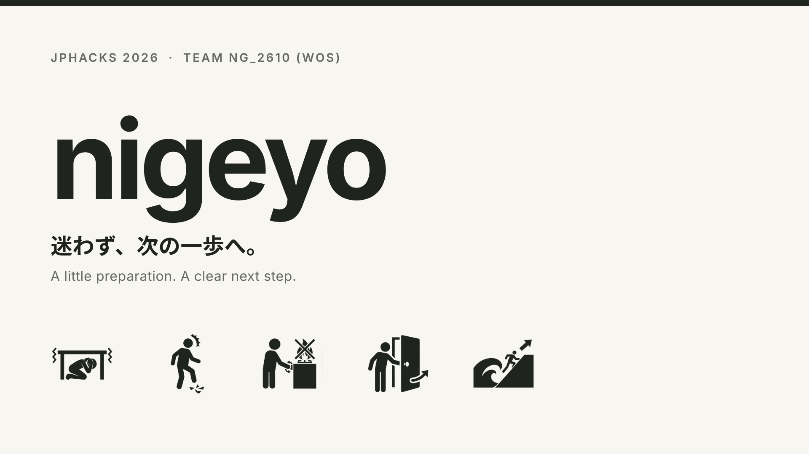
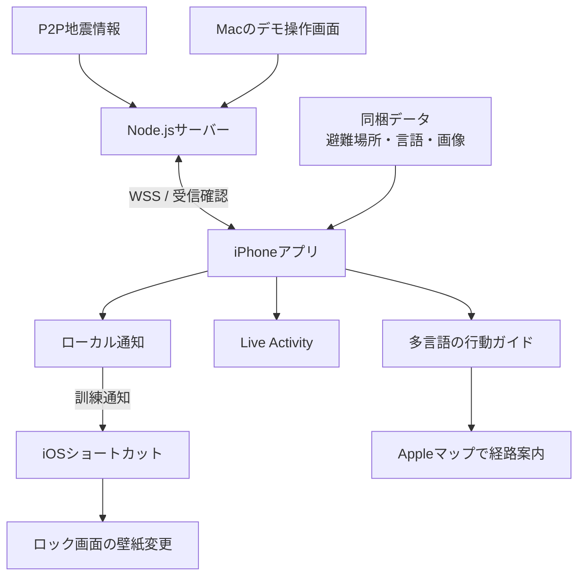

### 製品名・一言説明・動画

# nigeyo

## 在留外国人に向けた、地震速報に連動してiPhoneのロック画面に避難対応を視覚的に表示するアプリ

## 背景と課題

2026年10月16日、緊急地震速報の誤報がありました。チームの韓国人留学生メンバーのiPhoneにも速報が届き、アナウンスも聞こえました。地震が来る、ということは分かりました。しかし、そのあと何をすればよいかが分からず、動けませんでした。

「死ぬかもしれない」と思ったそうです。周りの留学生たちも、同じでした。

速報のあとに取る行動は、日本では、子どものころからの避難訓練で身についていることを前提にしています。頭を守る。周りを確かめる。火を確かめる。出口を確保する。日本で育った人は、考える前に体が動きます。

しかし、母国に地震がなく、訓練を受けたことのない人には、その行動がありません。知らせは届いても、行動が届いていないのです。

もし今、近くでトルネードが発生したら、あなたはどう動けばよいか分かりますか。分からない、という状態が、地震を知らない外国人にとっての、日本の地震です。

[愛知県の調査](https://www.pref.aichi.jp/uploaded/life/400803_1769795_misc.pdf)では、県内の在留外国人の51.8%が、防災訓練に参加していません。

幼いころから訓練を繰り返してきた日本人との間には、経験の差があります。

地震は、発生直後の数秒が分かれ目になります。しかし、経験がなければ、取るべき行動が分からず、動き出すことができません。

日本には、[412万人を超える在留外国人](https://www.nippon.com/ja/japan-data/h02750/)がいます

同じ状況に置かれる人は、彼だけではありません。あの誤報が本物だったら、最初の数秒の動揺が、彼らの命を奪っていたかもしれません。

nigeyoは、この差を痛感した留学生の開発者自身の経験をもとに、実装しました。速報を、「何をすればよいか」という行動に変えます。

地震のない国から来た人でも、日本で育った人のように、迷わず動ける。それが、私たちの目指すものです。

## 製品概要

**nigeyoは、地震に慣れていない留学生をはじめとする在留外国人に、「今、何をすればよいか」をロック画面から伝えるiPhoneアプリです。**

地震・津波の通知に連動して、ロック画面の壁紙を大きなピクトグラムへ自動で切り替えます。さらに、Live Activity上のボタン操作で、身を守る行動から揺れがおさまった後の安全確認まで進められます。**アプリを探して開かずに、絵と短い言葉で次の行動を確認できること**が特長です。

避難が必要な場合は、事前に登録した「自宅・学校 × 地震・津波」の避難先へ案内をつなぎます。日本語・英語・韓国語に対応し、言語と土地勘の両面から避難を支援します。

また、訓練モードでは、通知・壁紙の切り替えから安全確認・避難先選択までを体験できます。

**初めての地震でも、初めての行動にしない。**

平時に見慣れた画面と操作が、緊急時にも行動の手がかりになることを目指しています。

## 既存手段との違い

他にも災害・避難系のアプリは多くあります。

**しかし、私たちは実体験をもとに、地震本番での初期避難における実用性を突き詰めました。**

多くの既存のアプリは、利用者が文字による通知を読んでからアプリを開き、アプリ内で行動案内を確認するという方式です。緊急時にも画面操作と説明の読み取りが必要です。避難中や、突然の警報で混乱している場面では、その操作が負担になります。

また、ゲームや体験型学習、情報共有、3D地図、ハザードマップなどを活用するものもあります。これらが防災の学習や「どこへ、どう避難するか」を支えるのに対し、nigeyoは、その前段階の「警報を受けた瞬間、何をすればよいか」の伝わりやすさに注力しました。

地震発生直後の行動は命に直結しますが、その対応には、幼少期からの避難訓練による慣れや経験の差があります。

**スマホ壁紙の自動切り替えとLive Activityにより、アプリを探して開く操作を挟まずに、ロック画面から一連の行動案内を示します。**

地震に慣れていない利用者が、混乱した状況でも適切な初動をとれるよう支援します。

**初期避難における実用性が、nigeyoの強みです。**

利用者が情報を探す手間を抑え、身を守る行動が視覚的に伝わる設計にしています。

## 利用の流れ・主要機能

### 1. 初期設定　
<table>
<tr>
<td width="240" valign="top">

https://github.com/user-attachments/assets/6671cf77-be81-4415-af51-781fa2c0ea75

</td>
<td width="500" valign="top">
<h3>自分の言語、自宅・学校、避難先を設定する</h3>

初回起動時に、英語・日本語・韓国語から表示言語を選びます。その後、自宅と学校の場所を、住所・建物名の検索や地図上のピンで指定します。

登録した場所の周辺から、地震・津波それぞれに対応した避難場所を提案します。候補の位置や徒歩距離を自動で求め、**「自宅×地震」「自宅×津波」「学校×地震」「学校×津波」の4通りの避難先**を保存します。

災害が起きてから行き先を調べるのではなく、いつもの生活圏で「何が起きたら、どこへ向かうか」を準備しておけます。ログインやアカウント作成は不要です。

</td>
</tr>
</table>

### 2. ロック画面の壁紙
<table>
<tr>
<td width="340" valign="top">

</td>
<td width="460" valign="top">
<h3>通知が届くと、最初にとる行動が、大きな絵で出る</h3>

通知を許可して、地震・津波のショートカットと自動実行を設定します。緊急時に初めて設定する必要がないよう、壁紙の動作確認まで事前に行います。

設定後は、対応する通知をきっかけにロック画面の壁紙が切り替わり、地震では「机の下で頭を守る」、津波では「高台へ向かう」という行動を大きなピクトグラムで示します。

</td>
</tr>
</table>

### 3. Live Activity
<table>
<tr>
<td width="240" valign="top">

</td>
<td width="500" valign="top">
<h3>ロック画面のまま、ボタンで次の行動へ進む</h3>

地震発生直後は、Live Activityに「低い姿勢で、頭を守って。」と表示します。揺れがおさまり、安全に操作できる状態になったら、**「揺れがおさまりましたか」ボタンを押すだけで、次の案内へ切り替わります。**

続いて、「安全確保」「火を消す」「扉を開ける」の3つの行動を、ピクトグラムと短い言葉で表示します。火の元や出口の確認は、安全に行える範囲で進めます。

**アプリを開かずに、ロック画面上で初動から安全確認まで進められる**ため、画面操作や情報を探す負担を減らせます。今いる場所が安全ではないと感じた場合は、**「安全でないと感じたら」ボタンから、アプリの避難先選択へ進めます。**

</td>
</tr>
</table>

### 4. 避難先の確認

<table>
<tr>
<td width="240" valign="top">

https://github.com/user-attachments/assets/c19f0376-ff9c-47aa-ae27-79dc3722a936

</td>
<td width="500" valign="top">
<h3>今いる場所と、災害の種類に合った避難先を表示する</h3>

避難が必要なときは、「家」「学校」「その他」から現在いる場所を選びます。

| 今いる場所 | 表示する避難先 |
| --- | --- |
| 家 | 事前に保存した、自宅の地震・津波別の避難先 |
| 学校 | 事前に保存した、学校の地震・津波別の避難先 |
| その他 | 現在地周辺の、災害の種類に対応した避難場所の候補 |

津波の情報を受け取った場合は、地震の確認操作を待たずに津波の案内へ切り替え、津波に対応した避難先を表示します。

避難場所データはアプリ内に保存しているため、通信できない場合でも登録先の確認と近隣候補の検索が可能です。経路を確認したい場合は、Apple標準のマップアプリへ引き継ぎます。

</td>
</tr>
</table>

### 5. 「揺れを感じました」
<table>
<tr>
<td width="240" valign="top">

https://github.com/user-attachments/assets/90027ff6-83ef-4fe2-a881-0b52b0adeb6e

</td>
<td width="500" valign="top">
<h3>通知を待たず、自分で揺れを感じた時点から始める</h3>

自分で揺れを感じたときは、ホームの「揺れを感じました」から、身を守る行動ガイドを直接開けます。

通知の到着を待つ必要はありません。その後も、安全確認から避難先の選択まで、同じ流れで進めます。

</td>
</tr>
</table>

### 6. 訓練モード
<table>
<tr>
<td width="240" valign="top">

https://github.com/user-attachments/assets/a4e70256-4684-418d-b437-e6c6f94800d9

</td>
<td width="500" valign="top">
<h3>初めての地震でも、初めての行動にしない</h3>

ホームから「地震」「津波」「地震＋津波」の訓練を選べます。開始後はスマートフォンをロックし、訓練通知を待ちます。

**通知 → 壁紙の切り替え → 身を守る行動 → 安全確認 → 避難先の選択**まで、本番を想定した画面と操作を体験できます。地震・津波単体の訓練では、開始から3秒後に通知が届きます。地震＋津波では、地震の通知に続いて津波への切り替えも練習できます。

訓練では外部の地震情報を取得せず、端末内で通知を予約します。通知や画面には「訓練」と表示し、実際の災害情報と区別します。

**初めての地震でも、初めての行動にしない。**

見慣れたピクトグラムと操作を通して、緊急時の戸惑いを減らすことを目指しています。

</td>
</tr>
</table>

## 解決できること

**初めての地震でも、「何をすればよいか分からない」から、「見たことがあるから対処できる」へ。**

日本で育った人の多くは、子どものころからの避難訓練を通じて、「地震のときは、こう動く」という経験を重ねています。一方、地震の少ない国・地域から来た人には、その経験がない場合があります。速報の言葉が分かっても、次に何をすればよいか分かるとは限りません。

nigeyoは、この経験の差を、**その場での行動案内と、平時の訓練体験**で埋めることを目指します。

### 1. 警報を、具体的な行動につなげる

通知に連動して壁紙が切り替わり、「頭を守る」「高台へ向かう」といった最初の行動を、大きなピクトグラムで示します。揺れがおさまった後も、Live Activityで周囲の安全・火の元・出口の確認へつなぎます。

**危険を知るだけで終わらず、次にとる行動をその場で確認できます。**

### 2. 本番の前に、行動の経験をつくる

訓練モードでは、通知、壁紙の切り替え、安全確認、避難先選択まで、本番と同じ画面と操作を繰り返し体験できます。

**「この画面は見たことがある」「この操作はやったことがある」状態をつくり、緊急時の戸惑いを減らします。**

知識を読むだけでなく、自分で操作して備えられます。

### 3. 余裕のない非常時に、操作と判断の負担を減らす

突然の警報に驚いているときや、身を守る必要があるときには、アプリを探して長い説明を読む余裕はありません。

nigeyoは、**ロック画面の壁紙とLive Activityで、初動から安全確認までを案内します。**

必要な操作をボタンでの確認に絞り、利用者が情報を探す手間を抑えます。避難が必要になった場合は、事前に登録した災害別の避難先を確認できます。

### 4. 言語の壁を下げ、行動を視覚で伝える

緊急時の日本語による指示は、日本語が得意でない人にとって読み取りの負担になります。

nigeyoは、**視覚的なピクトグラムを中心に、英語・日本語・韓国語の短い言葉を添えて案内します。**

長い文章を読み解く負担を減らし、日本語力に左右されにくい形で、必要な行動を伝えます。

## 独自実装・注力したこと（技術的こだわり等）

### 1. 壁紙変更を端末内で完結させる

災害時には通信が不安定になる可能性があります。行動を示す画像を通知のたびにダウンロードする方式では、通知を受け取れても、肝心の画像を表示できないおそれがあります。

そこで、地震・津波それぞれの壁紙画像を埋め込んだ署名済みショートカットを、アプリに同梱しました。事前にショートカットと自動化を設定することで、**壁紙変更時の画像取得を不要にし、端末内で切り替えられるようにしています。**

### 2. 実情報の監視と訓練を分ける

平時の訓練は、実際の地震の発生や外部サーバーの稼働状況に左右されず、繰り返し試せる必要があります。また、実情報を扱う経路では、過去のデータを現在の災害情報として通知しないことが重要です。

そのため、アプリ内訓練では外部の地震情報を取得せず、端末内で通知を予約します。Macやサーバーに接続しなくても、通知から行動確認・避難先選択までを体験できます。

一方、実情報の自動監視では、P2P地震情報から受け取った緊急地震速報・津波情報を、登録先の地域と照合します。

**実情報の監視には、取得失敗時の過去データへのフォールバックを使用しません。**

訓練の通知や案内には「訓練」と表示し、実際の災害情報と区別しています。

### 3. 通信の再送や情報の更新で、案内を混乱させない

通信が不安定な場面では、同じ情報が再送されることがあります。そのたびに通知が重複したり、確認中の案内が最初に戻ったりすると、利用者の混乱につながります。

そこで、受信済みの識別子と案内の状態を保存し、同じ情報の再送による重複通知や、案内の不要なやり直しを防いでいます。

また、津波の情報は、利用者が地震の確認操作を終えるまで待つべきではありません。

**津波情報を地震の確認操作と独立して扱い、警報の強化・引き下げ・取消に応じて状態を更新します。**

通信断や時間の経過だけでは、警報が解除されたとは扱いません。

### 4. 通信できなくても、避難先を確認できるようにする

避難が必要になってから外部サービスに問い合わせる方式では、通信が途切れたときに行き先を確認できなくなります。また、地震に対応する避難場所が、津波にも対応しているとは限りません。

そのため、国土地理院の全国の指定緊急避難場所データから、地震・津波に対応する施設を抽出し、JSONとしてアプリに同梱しています。

**保存済みの避難先の確認と、災害種別に対応した近隣候補の検索を、オフラインでも利用できます。**

地図表示や経路案内は、別途Appleマップを使用します。

### 5. 言語を増やしやすく、文言の不足を見つけやすくする

対象となる利用者の言語はさまざまです。言語を追加するたびに画面のコードを修正する方法では、対応を広げる負担が大きくなり、文言の追加漏れも起こりやすくなります。

そこで、表示文言をSwiftの画面実装から分離し、言語別のJSONで管理しています。所定の形式のJSONを追加し、検証・取り込みを行うことで、画面のコードを変更せずに言語を追加できます。

**必要な文言の不足や、埋め込み変数の不一致は自動検証しています。**

翻訳の意味や伝わりやすさについては、別途、利用者による確認を行います。

### 6. 避難先の準備に使う、自宅・学校の入力情報を残さない

自宅・学校の住所や位置は、近くの避難先を選ぶために必要です。一方、選び終えた避難先を表示するために、元の入力情報を保存し続ける必要はありません。

そのため、自宅・学校の入力情報は永続保存せず、登録完了時にメモリから破棄します。端末には、選択した避難場所の施設情報と距離などを保存します。

**準備に必要な情報と、準備後も保持する情報を分け、保存する情報を必要な範囲に絞っています。**

### 7. 目的に合致するよう、壁紙とLive Activityを使い分ける

災害時の第一歩の行動は、スマホをじっと見ることなく、とっさに動ける必要があります。そこで、最初の行動である「頭を守る」「高台へ向かう」のピクトグラムは、表示できる大きさに限りのあるLive Activityではなく、壁紙として画面全体に大きく表示し、ひと目で分かるようにしています。

その上に重ねるLive Activityは、揺れがおさまったあとの確認(安全確保・火の元・扉)に使います。ボタンで次の案内に進めるので、情報を探す操作が要りません。

壁紙は、最初の1つの行動を大きく見せる。Live Activityは、その後の手順を順番に進める。この役割分担で、非常時の負担を減らします。

## 今後の展望

1. **実際の利用者によるフィードバック**

   大学で、留学生の方々に実際に使ってもらい、フィードバックを得ます。ピクトグラムが伝わるか、訓練の画面で慣れられるかなどを、利用者の声で確かめ、改善につなげます。

2. **通知機能の強化**

   Apple Developer Programの認証を受け、APNsを利用した通知配送を実装し、アプリが前面にない状態での受信を実現します

3. **24時間稼働する通知基盤**

   現在は、開発用のMac上のサーバで動かしています。今後は、常時起動しているサーバを確保し、24時間いつでも通知を発信できるようにします。

4. **音声案内**

   母国語での音声案内を追加します。ポケットやかばんにスマートフォンが入っているときでも、取り出さずに行動できるようになり、より多くの場面で使えるようになります。

5. **地図の事前取得**

   地震が起きたと分かった時点で、通信が切断される前に、近くのエリアの地図のダウンロードを始める処理を入れます。これにより、避難所の場所は分かっても、地図が表示されない、という状況を防ぎ、より広い範囲の事象に対応できます。

6. **公開**

   可能であれば、一般の利用者が使える形で公開します。

## 技術構成

| 分類 | 使用技術・用途 |
| --- | --- |
| iPhoneアプリ | Swift / SwiftUI：画面構築・行動ガイド |
| ロック画面 | ActivityKit / WidgetKit：Live Activity表示、iOSショートカット：壁紙変更 |
| 通知 | UserNotifications：ローカル通知 |
| サーバー・通信 | Node.js / WebSocket：災害情報の取得・端末への配送、Cloudflare Tunnel：デモ接続 |
| 災害情報 | P2P地震情報：地震・津波情報の取得 |
| 避難場所・地図 | 国土地理院の指定緊急避難場所データ、MapKit / CoreLocation、Appleマップ |
| 多言語・オフライン | 言語別JSONで日本語・英語・韓国語に対応。避難場所・案内文言・壁紙画像を端末内に保持 |

### システム図

## 動かし方

### 最短で訓練を試す

初期設定を終えたiPhoneでは、Macやサーバーに接続せず、アプリ内訓練を体験できます。

1. ホームから訓練画面を開き、シナリオを選びます。
2. 訓練を開始し、iPhoneをロックします。
3. 開始から3秒後に予約された訓練通知を確認します。壁紙変更の自動化を設定済みの場合は、壁紙も切り替わります。
4. 安全に操作できる状態でアプリを開き、行動ガイドから避難先選択まで進みます。

「地震から津波」では、最初の通知から10秒後に津波の通知を予約します。壁紙変更後にアプリは自動起動しません。訓練終了後の壁紙は手動で元に戻してください。

ビルド・署名設定・Macから通知を送るデモの詳細は、[セットアップ手順](docs/setup.md)を参照してください。

- [ビルド・接続・デモの詳細](docs/setup.md)
- [壁紙変更ショートカットの設定](docs/shortcuts.md)
- [実情報の通知対象地域と制約](docs/registered-region-monitoring.md)
